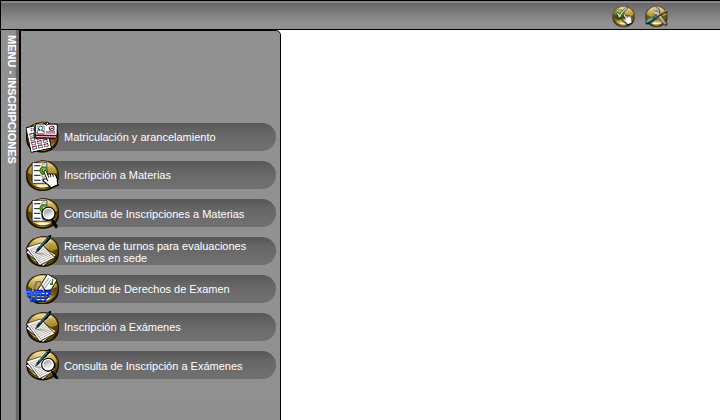
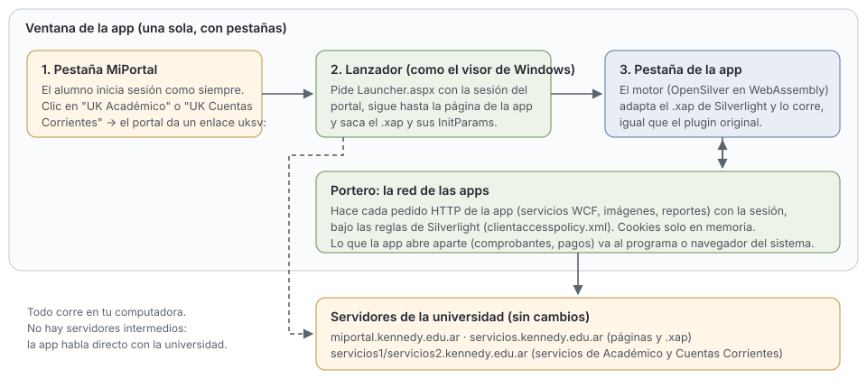

# Universidad Kennedy MiPortal App (no oficial)

[](https://github.com/JuaniVeltri/ukennedy-miportal-app/actions/workflows/ci.yml)
[](LICENSE)
[](https://github.com/JuaniVeltri/ukennedy-miportal-app/releases)

Usá **UK Académico** y **UK Cuentas Corrientes** de MiPortal en **Linux** y **macOS** (en prueba),
sin Windows, sin Internet Explorer y sin el plugin de Silverlight.

> **Proyecto independiente y no oficial.** No lo hace ni lo mantiene la Universidad Kennedy ni
> GGI; se desarrolla con su autorización y como código abierto. "Universidad Kennedy" y
> "MiPortal" se nombran solo para indicar con qué sistemas funciona.



## Qué hace

Las aplicaciones de MiPortal (Académico, Cuentas Corrientes) están hechas en Silverlight, una
tecnología que Microsoft discontinuó en 2021. La universidad las abre con su "Visor de
Aplicaciones UK", que solo existe para Windows. Desde Mac o Linux, el portal responde "La
aplicación no está disponible en este equipo".

Esta app es una ventana con pestañas:

- **MiPortal**: el portal de siempre. Iniciás sesión con tu usuario, como en el navegador.
- Al tocar **UK Académico** o **UK Cuentas Corrientes**, la app se abre en una **pestaña nueva**,
  con tus datos, tal como se veía en Windows: inscripción a materias, consultas, estado
  académico, comprobantes, pagos.

## Instalar

### Linux

1. Instalá WebKitGTK 4.1, el navegador que usa la app (en muchos sistemas ya está):
   - Fedora: `sudo dnf install webkit2gtk4.1`
   - Ubuntu / Debian: `sudo apt install libwebkit2gtk-4.1-0`
   - Arch: `sudo pacman -S webkit2gtk-4.1`
2. Bajá el `.tar.gz` de la [última versión](https://github.com/JuaniVeltri/ukennedy-miportal-app/releases).
3. Descomprimí e instalá (sin permisos de administrador, queda en tu usuario):

   ```sh
   tar xzf ukennedy-miportal-app-*-linux-x64.tar.gz
   cd ukennedy-miportal-app-*-linux-x64
   ./instalar.sh
   ```

4. Abrila desde el menú de aplicaciones: **Universidad Kennedy MiPortal App**.

Para quitarla: `~/.local/share/ukennedy-miportal-app/desinstalar.sh`. Si algo falla, el registro
está en `~/.local/state/ukennedy-miportal-app/registro.txt`.

### macOS (en prueba, Apple Silicon)

1. Bajá el `.dmg` de la [última versión](https://github.com/JuaniVeltri/ukennedy-miportal-app/releases)
   (o, para probar un cambio, de la sección *Artifacts* de su ejecución en
   [Actions](https://github.com/JuaniVeltri/ukennedy-miportal-app/actions)).
2. Abrilo y arrastrá **Universidad Kennedy MiPortal App** a **Aplicaciones**.
3. La app no está firmada por Apple (hace falta una cuenta paga de desarrollador), así que la
   primera vez macOS la bloquea. Abrila una vez, andá a **Ajustes del Sistema → Privacidad y
   seguridad** y tocá **Abrir igual**. También se puede desde la Terminal:

   ```sh
   xattr -dr com.apple.quarantine "/Applications/Universidad Kennedy MiPortal App.app"
   ```

Si algo falla, el registro está en `~/Library/Logs/UKennedyMiPortalApp/registro.txt` (no tiene
contraseñas ni datos de la sesión): adjuntalo en un [reporte](https://github.com/JuaniVeltri/ukennedy-miportal-app/issues/new/choose).
Qué cambia en Mac respecto de Linux: [docs/macos.md](docs/macos.md).

### Windows

Usá el visor oficial de la universidad.

## Cómo funciona



1. **Portal.** La primera pestaña es MiPortal. La app se presenta como Windows ante el portal
   (autorizado por la universidad), porque el portal solo ofrece las aplicaciones a Windows.
2. **El enlace `uksv:`.** Al tocar una aplicación, el portal entrega un enlace `uksv:`, el mismo
   que en Windows abre el visor oficial. La app lo atrapa y hace lo que hacía el visor: pide la
   página de la aplicación con tu sesión y saca de ella el archivo de la app (`.xap`) y sus
   parámetros.
3. **El motor.** Cada aplicación corre en su pestaña con el motor **Plata**: un reproductor de
   Silverlight de código abierto, hecho sobre [OpenSilver](https://opensilver.net) y WebAssembly.
   Plata lee el `.xap` original, adapta lo que difiere entre Silverlight y OpenSilver, y lo ejecuta.
4. **La red.** Cada pedido de la aplicación a los servidores de la universidad sale desde la app
   (el "Portero"), con tu sesión y bajo las mismas reglas que tenía Silverlight
   (`clientaccesspolicy.xml`). Lo que la aplicación abre aparte (comprobantes, el formulario de
   pago) se abre con el programa o el navegador de tu sistema.

### Privacidad

- **Todo corre en tu computadora.** No hay servidores intermedios: la app habla directo con la
  universidad.
- **No guarda tu contraseña.** Iniciás sesión en el portal, como en cualquier navegador.
- **La sesión vive en memoria** y se borra al cerrar la app.
- La app solo se conecta a los dominios de la universidad y a los que sus propias políticas
  permiten. Los documentos que abrís (comprobantes) quedan en una carpeta temporal tuya.

## Colaborar

¡Toda ayuda suma! Probar en otras distribuciones o en Mac, reportar errores, mejorar la
compatibilidad o la documentación. Leé la [guía para colaborar](CONTRIBUTING.md).

- ¿Algo falla o se ve distinto que en Windows? [Abrí un reporte](https://github.com/JuaniVeltri/ukennedy-miportal-app/issues/new/choose).
  **Tapá tus datos personales** (nombre, legajo, materias) en las capturas.
- ¿Un problema de seguridad? Reportalo en privado: [SECURITY.md](SECURITY.md).

### Estructura del código

| Carpeta | Qué hay |
|---|---|
| `src/Plata.Host` | La app de escritorio ([Photino](https://www.tryphotino.io)): ventana con pestañas, lanzador del portal, Portero (red), políticas de acceso, documentos. |
| `src/Plata.MotorWasm` | El motor que corre dentro de cada pestaña (Blazor WebAssembly + OpenSilver). |
| `src/Plata.Motor` | Lee el `.xap` y adapta sus ensamblados de Silverlight a .NET moderno y OpenSilver. |
| `src/Plata.Compat` | Lo que Silverlight tenía y OpenSilver no (o hace distinto): XAML, WCF, AES, WebClient, etc. |
| `tests/` | Pruebas (xUnit). No usan datos reales. |
| `empaquetado/` | Instalador para Linux y lanzador de la app. |
| `extension/` | Extensión de navegador experimental que detecta apps Silverlight en cualquier página. |
| `docs/` | Autorización, compatibilidad con las apps de la Kennedy, diseño y planes. |

### Desarrollo

Requisitos: [.NET 10 SDK](https://dotnet.microsoft.com/download), la carga de trabajo de WebAssembly
y WebKitGTK 4.1.

```sh
dotnet workload install wasm-tools
dotnet build Plata.slnx
dotnet test Plata.slnx

# Correr la app desde el código
dotnet publish src/Plata.MotorWasm -c Release -o /tmp/motor
dotnet run --project src/Plata.Host -- --motor /tmp/motor/wwwroot \
  --nombre "Universidad Kennedy MiPortal App (no oficial)" \
  --portal https://miportal.kennedy.edu.ar/ --portal-nombre MiPortal --permitir kennedy.edu.ar

# Armar el paquete de Linux (queda en dist/)
empaquetado/linux/empaquetar.sh 0.1.0
```

## Licencia

[MIT](LICENSE). Las aplicaciones de la universidad (los `.xap`) no forman parte de este
repositorio: la app las baja del servidor de la universidad cada vez que las abrís. El isotipo de
la Universidad Kennedy que usa el ícono (`empaquetado/icono.*`) es marca de la universidad y no
está cubierto por la licencia MIT.
